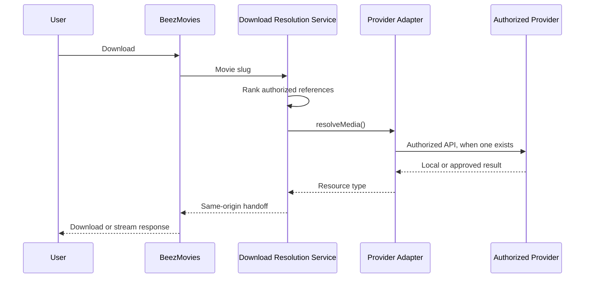

# Media providers and download resolution

PostgreSQL remains the catalog. `providers` and `media_references` stay the provider-agnostic records. The download service never stores a movie file or a short-lived provider URL.

The development provider does not call an external host. It generates the handoff on this machine. A future adapter may be registered only after that provider's official API and authorization rules are confirmed. If that provider requires the browser to open its own site, record that limit. Do not bypass authentication, hotlink protection, CAPTCHAs, or rate limits.

## Adapter

`MediaProviderAdapter` exposes `resolveMedia`, `getFileStatus`, `getMetadata`, `getDownloadUrl`, `getStreamUrl`, `validateReference`, and `healthCheck`. Controllers talk to the resolution service. They do not import a provider SDK.

The registry maps a provider slug to an adapter. `MEDIA_PROVIDERS` enables slugs. A missing or failing adapter does not stop the API. Credentials belong in server environment variables, never in PostgreSQL, the browser, or Git. `.env.example` shows the local names only.

## References

A media reference stores the movie, provider, external reference, media type (`download`, `stream`, or `embed`), normalized quality (`480p`, `720p`, `1080p`, `2160p`), size, duration, availability, status, non-secret metadata, and `last_checked_at`. Format lives in metadata. Trailers remain on `movie_videos` and are not downloadable files.

The download endpoint only ranks `download` references. A stream result is not treated as a file.

## Resolution

`POST /api/v1/movies/:slug/download` is public. Sign-in is not required. The body is an empty object, so a caller cannot submit `?url=` or a provider URL.

Selection is deterministic:

1. Active, enabled provider.
2. Download media, not a trailer or stream.
3. Requested quality when one was asked for, then higher quality.
4. Cached health: available, unknown, degraded, then unavailable.
5. Provider priority.
6. Most recent successful resolution.
7. Provider slug.

At most two providers are tried. Failover covers provider failure, timeout, an expired result, and a reference the adapter rejects. It does not retry forever.

The service checks protocol-like references, local and metadata hostnames, and unexpected URL fields before anything is returned. It does not fetch a user-supplied or reference-supplied URL. Signed handoffs expire after 60 seconds and are not written back to `media_references`. Request logs replace the handoff token with `:token`.

`download_events` stores the movie, reference, provider, result, and failure category. It does not store a person, address, or URL. `provider_health` stores available, degraded, or unavailable plus the last check. Health is read from that row for the candidates already loaded. A download does not scan every provider.

## Local development provider

`development-media` resolves references that start with `dev:ok:` or `dev-seed:`. Other `dev:` references simulate unavailable media, expiry, failure, and timeout. The handoff file is plain text generated in the API process.

## Adding a provider

Register an adapter that uses only that provider's documented API. Keep secrets in the server environment. Declare the hosts it is allowed to name. Return a resource type of `download` or `stream`. If the provider cannot give BeezMovies a file without sending the user to its own site, leave the adapter unresolved and document that visit instead of proxying around the control.
