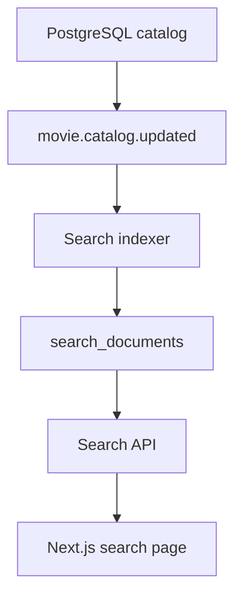

# Search and discovery

PostgreSQL is the catalog source of truth. The search index is a derived copy that can be deleted and rebuilt.

The local catalog does not justify a separate search cluster. PostgreSQL full-text search and `pg_trgm` cover keyword, title, alternate-title, people, and bounded typo matching. The query API talks to a repository, not to a vendor client, so a later OpenSearch, Elasticsearch, Meilisearch, or Typesense adapter can replace that repository without changing the frontend.

## Search document

`search_documents` stores one public document per movie per index version. The JSON uses the same movie summary shape as the catalog API. It includes title, synopsis, tagline, genres, language, year, poster, and collection name.

It does not include provider configuration, ingestion payloads, session data, or media-reference notes. Movie UUIDs stay in the table key and are not returned by `GET /api/v1/search`.

Columns used for matching and filters:

| Column | Use |
| --- | --- |
| `search_vector` | Weighted full-text document |
| `normalized_title`, `alternate_keys` | Exact and prefix title matching |
| `title_text`, `people_text` | Trigram typo matching |
| `genre_slugs`, `language_codes`, `country_codes`, `person_ids`, `collection_slug`, `release_year` | Filters |
| `popularity` | Editorial ranking only |

Archived and draft rows can exist in the index. Public search returns `status = active` only.

## Ranking

Text relevance and editorial signals are separate. Editorial score is `popularity * 0.05`, so it orders ties and does not outrank a title match.

| Match | Text score | When |
| --- | --- | --- |
| `exact_title` | 1000 | Normalized title equals the query |
| `prefix_title` | 700 | Normalized title starts with the query |
| `alternate_title` | 500 | An alternate title equals or contains the query |
| `text` | 200 plus a bounded `ts_rank_cd` boost | Full-text match on title, people, synopsis, tagline, or genre |
| `fuzzy` | trigram similarity times 100 | Query length is at least 5 and no stronger match exists |

The response reports `relevance.match` only. It does not return the numeric weights.

`plainto_tsquery` receives the query as a bound parameter. `catalog_normalize_text` strips the prefix and alternate comparisons down to letters and digits, so `%` and quotes cannot change the SQL.

## Endpoints

Public:

- `GET /api/v1/search?q=&page=&limit=&genre=&year=&language=&country=&collection=&person=`
- `GET /api/v1/search/suggestions?q=`
- `GET /api/v1/discovery/trending`
- `GET /api/v1/discovery/popular`
- `GET /api/v1/discovery/recent`
- `GET /api/v1/discovery/genres`
- `GET /api/v1/discovery/collections`

`q` is required for search and suggestions, from 2 searchable characters through 80 characters. Page size uses the catalog maximum of 50. Empty, wildcard-only, and unknown parameters return `400`.

Suggestions return at most 8 movies, people, genres, and collections. A search with no rows returns `data: []` and a `didYouMean` list of real indexed titles when a close trigram neighbor exists. The API does not invent movies.

Discovery lists reuse the catalog movie services. `GET /discovery/trending` lists active movies that signed-in members actually opened in the last 14 days. It is empty when that signal is missing. `GET /discovery/popular` is the editorial `popularity` score. `GET /discovery/recent` orders by `created_at`, the publication row time, not a later metadata refresh. Homepage sections are described in [recommendation-engine.md](recommendation-engine.md).

## Indexing

`search_index_events` from ingestion are consumed by the search worker:

- `movie.catalog.updated` rebuilds the document, including a status change
- `movie.catalog.archived` rebuilds it as archived so search hides it
- `movie.catalog.deleted` removes the derived document

Events are tried up to 5 times. The worker also claims `search_reindex_jobs`.

`POST /api/v1/admin/search/reindex` is admin-only. It enqueues a job and returns `202`. The HTTP request does not rebuild the catalog.

`rebuildSearchIndex()` reads movies in batches of 50, writes them into a new `building` version, then activates that version and deletes the previous one in the same transaction. The live version stays readable until the switch commits. `search_index_versions` allows one active version and one building version.

If `search_documents` is emptied, run the reindex job again. The catalog tables are unchanged.

## Cache and aggregates

Anonymous search responses are cached for 30 seconds. The key is index version, normalized query, filters, page, and limit. It does not contain a user or session. Requests that send a cookie skip the cache and use `Cache-Control: private, no-store`.

Redis uses the same optional client as the rest of the API. When Redis is down, a small in-process cache covers the same key. Reindex and document updates clear that memory cache. A document edited through an event can remain cached for the TTL.

`search_query_stats` stores the normalized query, result counts, and duration. It does not store addresses, account ids, or raw personal data.

## Search page

`/search` is a mobile-first field with suggestions, loading, empty, result, and error states. Its metadata sets `noindex`, and `robots.txt` disallows `/search`, so query URLs are not offered as landing pages. The canonical URL is `/search` without a query string.
